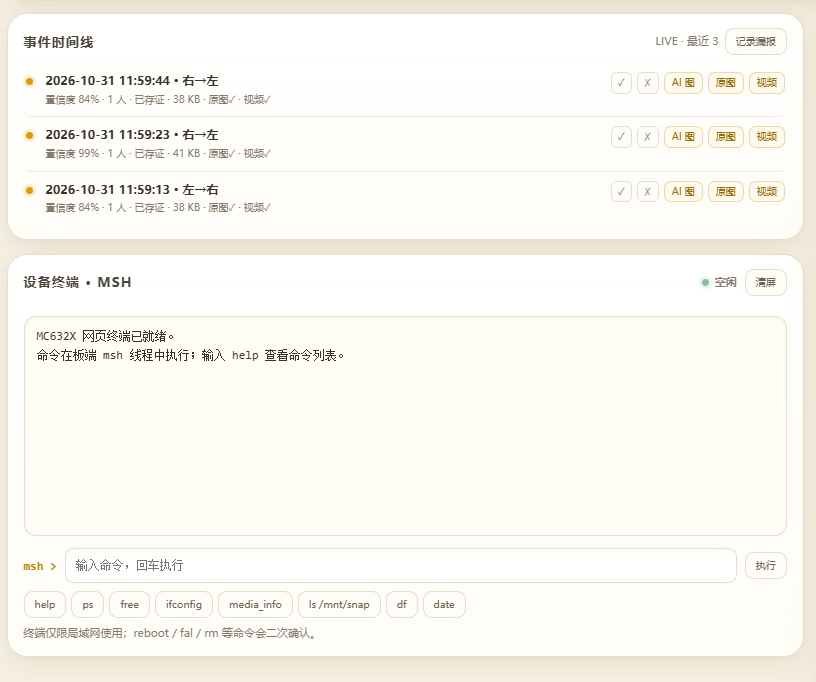
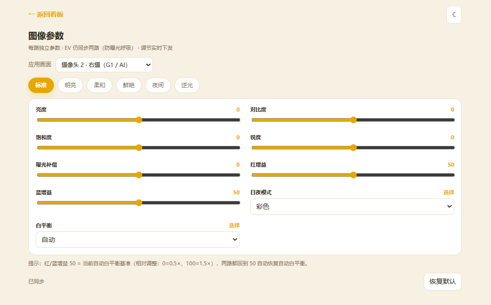
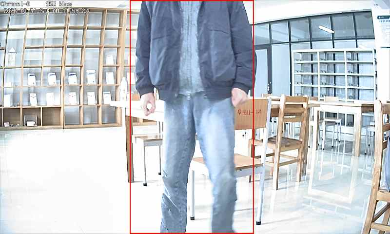
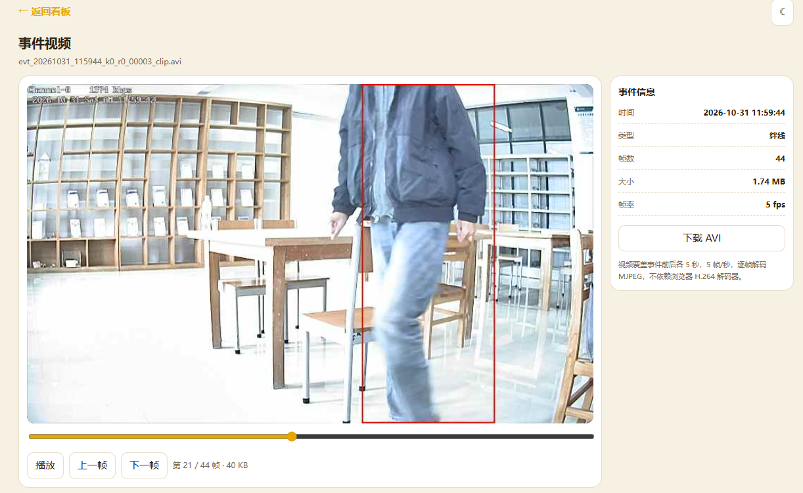
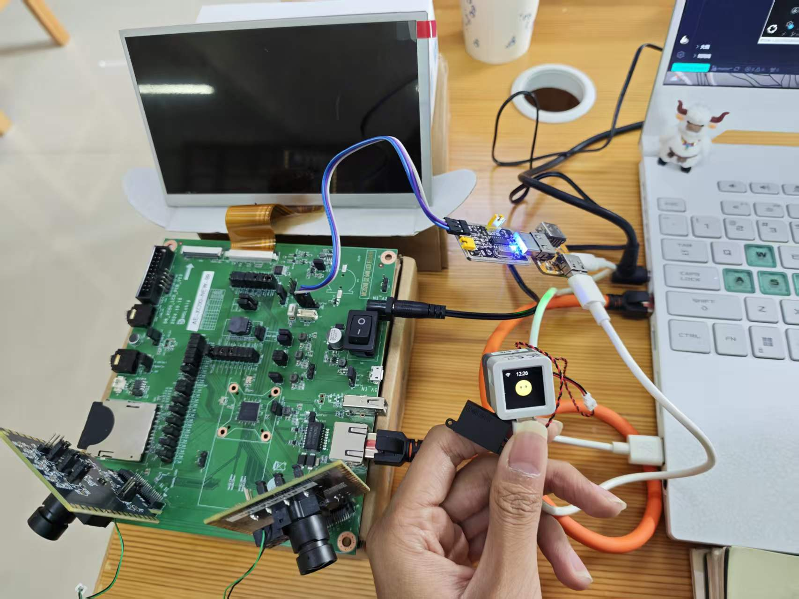

# SENTINEL · 双摄边缘 AI 安防系统

> 2026 RT-Thread 嵌入式软件大赛参赛作品
> 硬件：富瀚 MC632X 双摄开发板 + M5Stack AtomS3R（小智）
> 软件：RT-Thread（FH_RT V3.4.0 SDK）+ xiaozhi-esp32

SENTINEL 是一套**完全跑在本地、断网可用**的双摄边缘 AI 安防系统，面向 24 小时无人便利店、小型仓储、社区车棚这类“没有公网、也不愿把画面传上云”的场景。

白天它是“客流统计员”：双路实时预览、人形检测、绊线进出统计；夜里它是“守夜人”：周界布防、事件存证、录像留证；每天早上还能让小智用一句人话汇报“进入多少人、离开多少人、峰值多少人”。


## 功能特性

| 功能 | 说明 |
| --- | --- |
| 双路实时预览 | 两路 800×480 MJPEG，浏览器直接看 `:1111` / `:1112` |
| 人形检测 + IVS | NPU 人形检测，绊线（进出方向）与周界（入侵/离开/徘徊） |
| 事件存证 | 每次事件保存 AI 图 + 另一路原图 + 前后各 5 秒短视频 |
| 布防/撤防 | 网页一键布防，触发后自动存证并语音告警 |
| 快捷录制 | 固定 30 秒，点一下立即录，到点自动停并生成报告 |
| 定时录制 | 单次或每天重复，可选录左摄原画或右摄 AI |
| 人流量报告 | 进入/离开/峰值人数、帧数、文件大小，网页可查 |
| 小智语音 | 事件播报 + 人流量汇报，预生成 OGG 片段拼接，离线可用 |
| 板端看板 | 事件时间线、相册（左右分目录）、ISP 调参、系统状态、网页终端 |
| 双路 ISP 独立调参 | 亮度/对比度/饱和度/锐度/红蓝增益/日夜/白平衡按路独立，EV 同步防呼吸 |
| 本地存储 | `left/right` 分目录，录像与人流量报告一一对应 |
| 扩展命令 | msh / 网页终端新增 `cam`（切换 LCD 画面源）与 `snap`（抓拍存 SD） |
| 断网可用 | 所有页面、接口、文件都在板端，无需云服务 |

## 界面预览

<table>
<tr>
<td width="50%"><br><sub>事件时间线：AI 图 / 原图 / 视频一键取证；网页终端可直接执行 msh 命令</sub></td>
<td width="50%"><br><sub>双路 ISP 独立调参：亮度、对比度、饱和度、日夜、白平衡</sub></td>
</tr>
<tr>
<td width="50%"><br><sub>周界事件存证：带检测框的 AI 图，旁边同时保存无叠加原图</sub></td>
<td width="50%"><br><sub>事件短视频：前 5 秒 + 后 5 秒，逐帧 MJPEG 播放，可下载 AVI</sub></td>
</tr>
</table>

## 实机



- 富瀚 MC632X 双摄开发板（DB-XC00），板载 7 寸 800×480 RGB 屏、两路 cv2005 摄像头、microSD 与以太网；
- M5Stack AtomS3R + Echo Base 运行小智固件，通过 Wi-Fi 调用板端 HTTP 接口完成语音播报。

## 系统架构

```text
Sensor0 → ISP G0 ─┬→ VPU ch1 800×480 MJPEG → 网页预览 :1111
                  └→ 干净帧缓存 → 事件"原图"

Sensor1 → ISP G1 ─┬→ VPU ch1 800×480 MJPEG → 网页预览 :1112
                  ├→ VPU ch2 512×288 RGB888 → NPU 人形检测 / 绊线 / 周界
                  └→ VPU ch0 H.264 → RTSP 1240/1246/1248

NPU 事件 → 抓拍 / 短视频 / 人流量统计 → SD 卡（/mnt/snap/left|right）
板端网页 :8080 ← 状态 / 事件 / 录像 / 报告 / ISP / 终端
M5Stack AtomS3R（小智）← HTTP 轮询 → 语音播报
```

## RT-Thread 使用情况

| 方面 | 使用方式 |
| --- | --- |
| 线程 / IPC | 业务全部以 RT-Thread 线程运行；互斥量保护 SD 与事件环，信号量驱动事件存证线程；不改动内核 |
| DFS + elmfat | SD 挂载 `/mnt`，抓拍/录像/报告走 POSIX 文件接口，开启 `_FS_REENTRANT` 支持多线程访问 |
| lwIP | 板端 HTTP、MJPEG 推流、RTSP、小智接口都跑在 lwIP 上；针对双路预览调大发送缓冲与接收窗口 |
| finsh / msh | 保留 `vlcview`、`media_info`、`top`、`df`、`pinctrl` 等命令用于现场调试，并在网页终端里复用 |
| 设备框架 | MMC、LCD、以太网、RTC 通过设备框架访问；SD 1-bit 配置在 board 层完成 |
| Kconfig | 编码通道、MJPEG、NN、SD、RTSP 等通过 SDK 的 Kconfig 配置，应用层不写死硬件参数 |

主要线程（节选）：

| 线程 / 任务 | 职责 | 说明 |
| --- | --- | --- |
| MJPEG 发送（每路一个） | 从 VENC 取流并推送到 libmjpeg | SDK 例程线程 |
| AI 推理（IVS） | 取 512×288 帧、NPU 推理、TAD 事件、GBOX 绘制 | SDK NNA 例程 |
| 事件存证 `snap_evt` | 写事件图 / 短视频、维护事件环 | 优先级 140，独立线程写卡 |
| 录像写入 `rec` | 帧队列 → MJPEG AVI 写 SD | 200ms/帧，队列 12×128KB |
| 网页服务 `osd_web` | HTTP :8080，页面与接口 | 优先级 130，单线程 |
| lwIP tcpip | 协议栈 | 优先级 100 |
| 小智 EventWatcher | 轮询事件与播报请求 | 运行在 ESP32-S3 侧 |

## 关键设计

- **双摄协同取证**：G1 跑 AI 并保存带框证据图，G0 同时保存无叠加原图；录像也可选任一路。
- **事件闭环**：检测 → 存证（图 + 5 秒视频）→ 人流量报告 → 小智语音，全部本地完成。
- **SD 可靠性**：修复卡空闲超时误判，命令响应超时 2 秒；默认 1-bit 12.5MHz，连续出错自动降到 6.25MHz；驱动复位后自动“卸载 → 卡重新枚举 → 重新挂载”，长时间录像不再需要重启。
- **单线程 HTTP 优化**：lwIP 窗口/缓冲调优、关闭 Nagle、头体合并发送、后台标签页暂停轮询。
- **离线语音**：19 个预生成 OGG 片段拼接中文数字，不依赖云端 TTS。

## 仓库结构

```text
sentinel-mc632x/
├── README.md                  # 本文
├── NOTICE.md                  # 第三方与 SDK 说明
├── docs/
│   └── 使用说明.md            # 编译、烧录、配置、使用、排障
├── screenshots/               # 演示截图（占位说明）
├── mc632x/                    # 富瀚 MC632X 端
│   ├── overlay/               # 相对 SDK 根目录的源码覆盖层
│   ├── config/                # 参考 .config / config.h
│   └── apply_overlay.sh       # 安装脚本（自动备份原文件）
└── xiaozhi/                   # 小智（AtomS3R）端
    ├── overlay/               # 新增/修改的板级源码
    ├── assets/common/         # 语音片段 OGG
    ├── patches/               # 对 xiaozhi-esp32 的两处修改
    └── apply_overlay.sh       # 安装脚本
```

> 本仓库**不包含富瀚 SDK 原始工程**，也不包含完整的 xiaozhi-esp32 仓库。
> `mc632x/overlay/` 是“相对 SDK 根目录”的覆盖层，只会替换本项目改动/新增的文件；
> 安装脚本会先把原文件备份成 `*.pre_sentinel`，不会删除任何东西。

## 快速开始

1. 准备富瀚 FH_RT V3.4.0 SDK（含 FP11 补丁）与 `arm-fullhanv2-eabi-` 工具链；
2. 执行 `mc632x/apply_overlay.sh /path/to/FH_RT_V3.4.0_20250123`；
3. 按 `docs/使用说明.md` 配置、编译、烧录；
4. 小智端按 `xiaozhi/apply_overlay.sh` 覆盖文件、打补丁，`idf.py build/flash`；
5. 浏览器打开 `http://<板子IP>:8080/`。

完整步骤见 [docs/使用说明.md](docs/使用说明.md)。

## 预编译固件（快速测试）

不想先编译，可以直接用 [`firmware/`](firmware/) 下本次比赛的 MC632X 固件：

| 文件 | 用途 |
| --- | --- |
| `sentinel_20261031_1157_9295ba47.bin` | 无头 bin，bootcmd 从 `0x120000` 读取时用 |
| `sentinel_20261031_1157_9295ba47.img` | 带 16 字节头的镜像，厂商默认 bootcmd 从 `0x120010` 读取时用 |

- 版本：SENTINEL 1.0，编译于 2026-10-31 11:57:40
- md5：`9295ba4739f5be164a9270ceade25e60`（bin）/ `0869a07a4cc1252c36cf4a43c488b417`（img）
- 烧录命令、bootcmd 判断和注意事项见 [firmware/README.md](firmware/README.md)。

小智固件不在 `firmware/` 里，需要按使用说明第 8 节单独编译烧录。

## 可复现性

已在**全新解压的 FH_RT V3.4.0 SDK** 上验证：应用覆盖层后 `make lib` / `make app` 通过，生成的固件与发布版本的 `.text` 段（2,077,932 字节）和符号表完全一致，仅编译路径字符串与 `__DATE__/__TIME__` 不同（`.data` 相差 616 字节）。复现记录见 `mc632x/` 覆盖层与使用说明。

## 演示材料

- 演示视频：`<待补充 B 站链接>`
- 实机与看板截图：放在 `screenshots/`（见该目录说明）

## 适用与限制

- 目前只做人形检测，不含人脸识别；语音为事件/报告驱动的模板播报，不是自由对话；
- SD 卡为 1-bit 12.5MHz，长时间录像请使用正牌 Class10 及以上卡；
- 本作品为竞赛原型，未做安防产品认证。

## 许可与声明

本项目新增代码以 MIT 协议开源（见 `NOTICE.md`）。
其中 `mc632x/overlay/` 里标注为 SDK 覆盖层的文件修改自富瀚官方 SDK，版权归原厂所有，仅用于学习交流，请通过官方渠道获取 SDK；`xiaozhi/` 下的文件基于开源项目 [xiaozhi-esp32](https://github.com/78/xiaozhi-esp32)（MIT）修改，遵循其原始许可。
