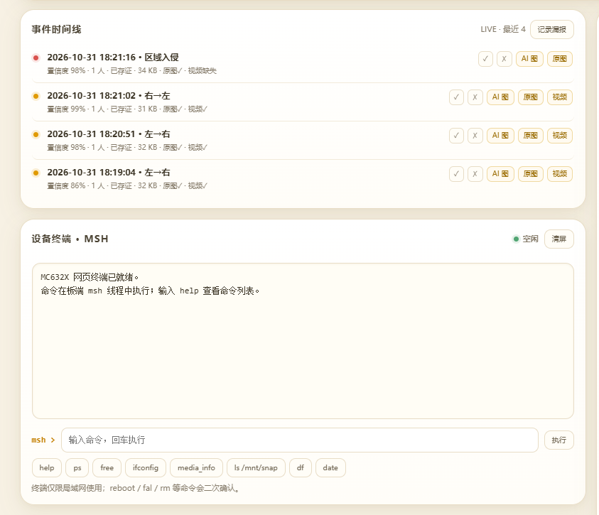
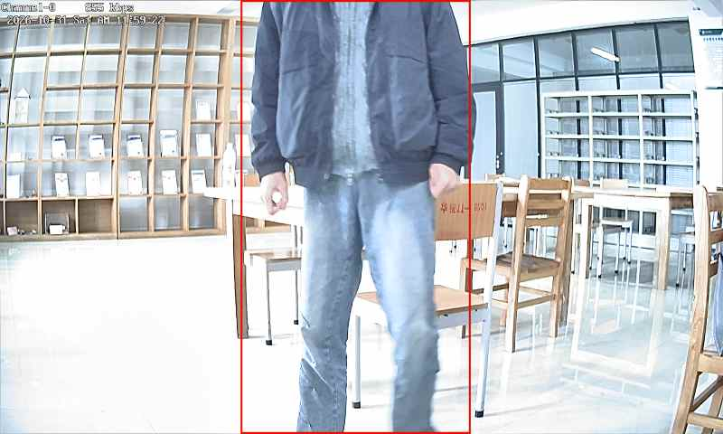
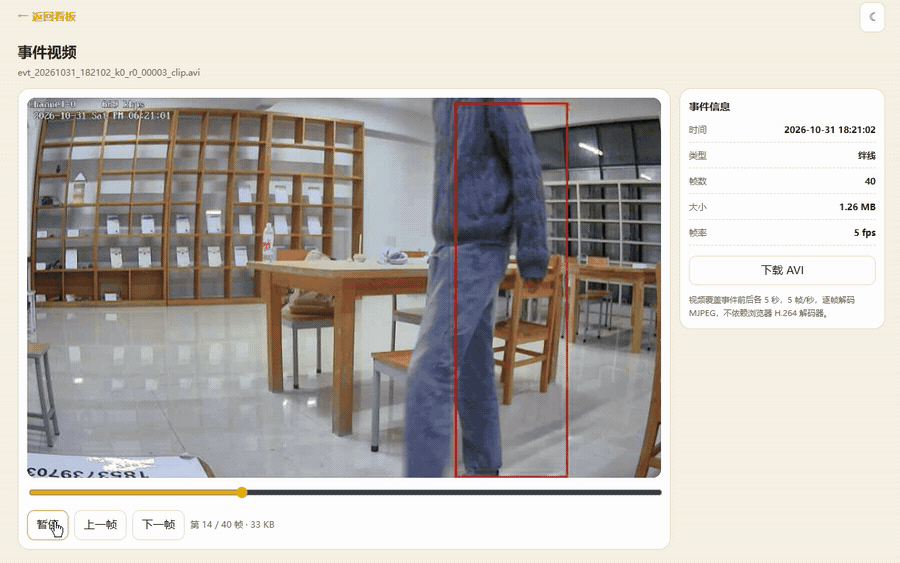
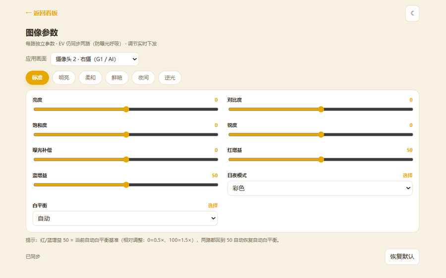
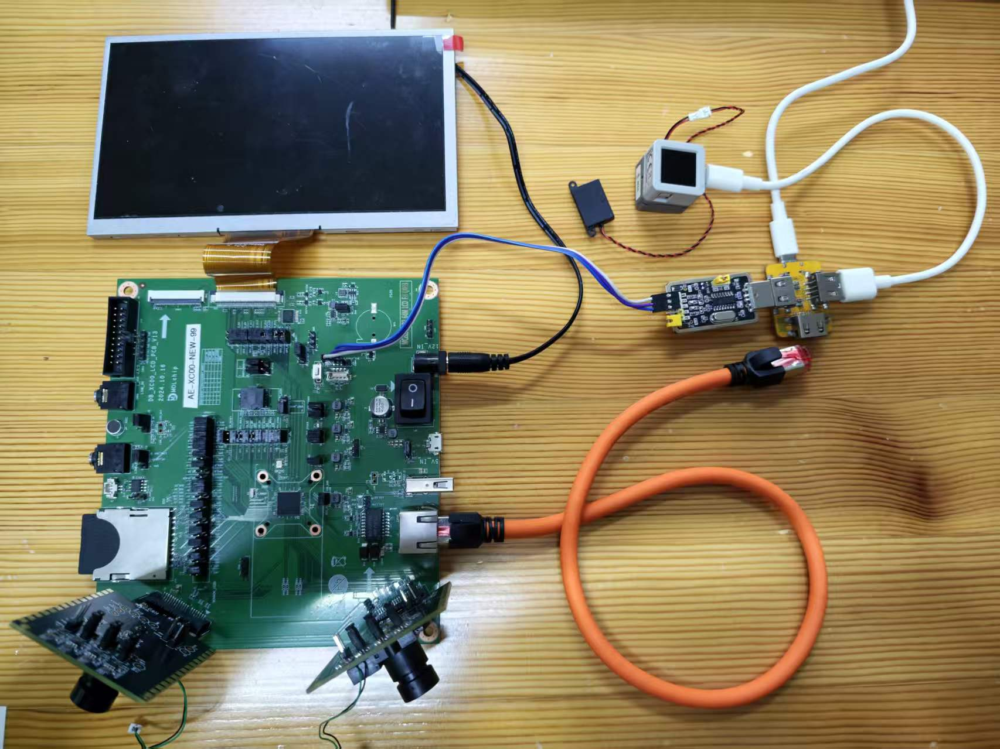
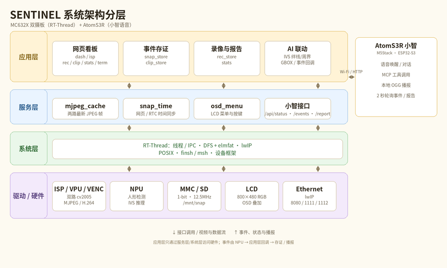
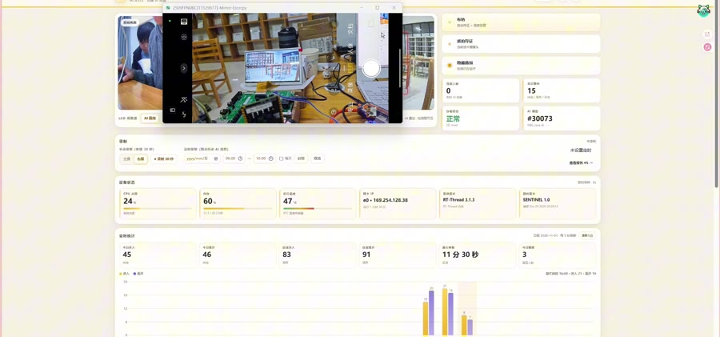

# 〖2026嵌入式大赛〗SENTINEL：双摄边缘 AI 无人店安防

> 已发布：<https://club.rt-thread.org/ask/article/9e71373f11ab99d3.html>

> **硬件平台**：富瀚 MC632X 双摄开发板（DB-XC00 + AT070TN94 7 寸 800×480 RGB 屏）、M5Stack AtomS3R
> **软件平台**：RT-Thread（FH_RT V3.4.0 SDK）、xiaozhi-esp32
> **开源仓库**：<https://github.com/yh-xh/sentinel-mc632x>
> **预编译固件**：<https://github.com/yh-xh/sentinel-mc632x/tree/main/firmware>
> **演示视频**：[B 站 · 14:24](https://www.bilibili.com/video/BV1XHx46AEoj/)

## 一、项目概述

凌晨两点，卷帘门外传来脚步声。店里没有人，店主在家里睡觉。

这不是想象中的场景。随着 24 小时无人便利店、无人值守小仓库在社区和城郊铺开，“看得见”和“留得下证据”成了最朴素也最刚性的需求：白天店主想知道进了多少人、什么时候是高峰；夜里卷帘门和后门需要有人盯着，陌生人靠近要立刻告警、留图、留视频；出事之后，需要的不是一句“好像有人来过”，而是一张看得清的事件图、一段前后各 5 秒的现场视频、一份说清楚“几点、几个人、从哪进哪出”的报表。

与此同时，这类店铺往往没有稳定的公网，店主也不愿意把摄像头画面传到别人的服务器上。

**SENTINEL 就是为这个场景做的**：一套完全跑在本地、不依赖公网的双摄边缘 AI 安防系统。板端功能不需要外网、不产生订阅费，画面和证据只存在店里那张 SD 卡上。白天它是“客流统计员”，夜里它是“守夜人”，每天还能用一句人话向店主汇报。

系统由两块板组成：

- **富瀚 MC632X 双摄板**：双路 ISP、视频编码、NPU 推理、事件存证、录像、网页服务；
- **M5Stack AtomS3R**：运行小智固件，负责语音交互、事件播报和人流量汇报。

核心能力可以概括为一句话：**双路实时预览 + 人形检测 + 绊线/周界布防 + 事件图/短视频存证 + 30 秒快捷录制/定时录制 + 人流量报告 + 小智语音汇报，全部本地完成。**

### 离线能力说明

- **无公网、有局域网**：MC632X 的全部功能、网页/RTSP、小智的事件/报告播报都可以正常使用；
- **完全无网络**：检测、事件存证、录像仍在板端本地运行（布防/定时需提前设置），但网页、RTSP 和小智不可访问；
- **小智语音**：事件/报告播报是本地 OGG 片段拼接，不依赖小智云；唤醒后的语音对话需要小智的云服务，离线不可用。


## 二、功能介绍

| 功能 | 实现说明 |
| --- | --- |
| 双路实时预览 | 两路 800×480 MJPEG，浏览器直接打开 `:1111` / `:1112`，无需客户端 |
| 人形检测 + IVS | NPU 人形检测，支持绊线（进入/离开方向）与周界（入侵/离开/徘徊） |
| 事件存证 | 每次事件同时保存 **AI 机位带框图 + 副机位画面（近景/另一角度）+ 前后各 5 秒短视频** |
| 布防 / 撤防 | 网页一键布防；触发后自动存证，并可选语音告警 |
| 快捷录制 | 固定 30 秒，点一下立即录，到点自动停并生成报告 |
| 定时录制 | 单次或每天重复，可选录左摄（无叠加画面）或右摄 AI |
| 人流量报告 | 进入/离开/峰值人数、帧数、文件大小，网页可查 |
| 小智语音 | 事件播报 + 人流量汇报，预生成 OGG 片段拼接，播报不依赖小智云（语音对话仍需联网） |
| 板端看板 | 事件时间线、相册（左右分目录）、ISP 调参、系统状态、网页终端 |
| 双路 ISP 独立调参 | 亮度/对比度/饱和度/锐度/红蓝增益/日夜/白平衡按路独立，EV 同步防呼吸 |
| 本地存储 | `left/right` 分目录，录像与人流量报告一一对应 |
| 不依赖公网 | 检测/存证/录像/报告在板端完成，网页与 RTSP 走局域网；小智报告播报用本地音频片段 |

### 事件时间线：一次事件就是一条完整证据链



时间线里每条事件都带置信度、人数、存证状态，以及「AI 图 / 原图 / 视频」三个入口（原图即副机位画面），还可以人工标注误报/漏报。下方的网页 msh 终端可以直接跑板端命令，现场排障不用接串口。

### 区域留证与视频取证





▶ [完整 MP4（约 7 MB）](https://raw.githubusercontent.com/yh-xh/sentinel-mc632x/main/screenshots/videos/%E8%A7%86%E9%A2%91%E5%8F%96%E8%AF%81.mp4)

短视频用 MJPEG AVI 封装（前后各 5 秒，5fps），网页逐帧解 JPEG 播放，不依赖浏览器 H.264 解码器，跨平台最稳。

### 双路 ISP 独立调参



亮度、对比度、饱和度、锐度、红蓝增益、日夜模式、白平衡都可以按摄像头分别调；EV 强制同步两路，避免两个 AE 控制环互相拉锯导致画面呼吸式忽明忽暗。

## 三、硬件框架



| 部分 | 型号 / 配置 | 说明 |
| --- | --- | --- |
| 主控 SoC | 富瀚 MC632X（Cortex-A7 + DSP/ARC 双核） | 双 ISP、VPU 编码、NPU 推理 |
| 图像传感器 | 2 × cv2005 | 分别接 ISP G0 / G1 两路 |
| 显示 | AT070TN94，800×480，18-bit RGB | 板载 LCD，OSD 叠加 |
| 存储 | SD 卡（SD0） | 1-bit 模式，12.5MHz |
| 网络 | 板载以太网（lwIP） | 网页、RTSP、小智接口 |
| 语音端 | M5Stack AtomS3R（ESP32-S3） | 小智固件，Wi-Fi 访问板端 HTTP API |

硬件上有三个绕不开的约束，后面的软件设计基本都是被它们逼出来的：

1. **LCD 与 SD0 共用引脚**，SD 卡只能工作在 1-bit 模式；
2. **AI 模型输入固定 512×288**，NPU 会校验帧尺寸，换分辨率直接失败；
3. 网页服务是**单线程**的，任何一次慢 I/O 都会拖住整页。

数据流：

```text
Sensor0 → ISP G0 ─┬→ VPU ch1 800×480 MJPEG → 网页预览 :1111
                  └→ 副机位帧缓存 → 事件"副机位画面"

Sensor1 → ISP G1 ─┬→ VPU ch1 800×480 MJPEG → 网页预览 :1112
                  ├→ VPU ch2 512×288 RGB888 → NPU 人形检测 / 绊线 / 周界
                  └→ VPU ch0 H.264 → RTSP 1240/1246/1248

NPU 事件 → 抓拍 / 短视频 / 人流量统计 → SD 卡（/mnt/snap/left|right）
板端网页 :8080 ← 状态 / 事件 / 录像 / 报告 / ISP / 终端
M5Stack AtomS3R（小智）← HTTP 轮询 → 语音播报
```

## 四、软件框架

### 4.1 分层结构



> 右侧虚线框为**后续规划**的扩展节点（ESP32/STM32，UART/网络），当前版本未实现。

```text
应用层   SENTINEL 业务
         ├─ 网页看板（dash / isp / rec / clip / stats / sys / term）
         ├─ 事件存证（snap_store / clip_store）
         ├─ 录像与人流报告（rec_store / stats）
         └─ AI 联动（IVS 回调、GBOX 叠加）

服务层   mjpeg_cache（帧缓存）、snap_time（时间同步）、osd_menu（LCD 菜单）

系统层   RT-Thread：线程/IPC、DFS + elmfat、lwIP、POSIX、finsh/msh、设备框架

驱动层   ISP / VPU / VENC / NPU（SDK 库）、MMC、LCD、以太网
```

### 4.2 主要模块

| 模块 | 作用 |
| --- | --- |
| `mjpeg_cache` | 缓存两路最新 JPEG 帧，抓拍和事件取帧零额外开销 |
| `snap_store` | 抓拍、事件图、相册、左右分目录、SD 挂载管理 |
| `clip_store` | 事件前 5 秒 + 后 5 秒 MJPEG 短视频 |
| `rec_store` | 30 秒快捷录制、定时录制、AVI 封装、自动重挂 |
| `stats` | 进入/离开/峰值统计，录制会话计数 |
| `osd_web_*` | 看板、ISP 调参、录像/报告、相册、网页终端 |
| `sample_nna_ivs` | 人形检测、绊线/周界、TAD 事件、OSD 叠加 |

### 4.3 RT-Thread 使用情况

| 方面 | 使用方式 |
| --- | --- |
| 线程 / IPC | 业务全部以 RT-Thread 线程运行；互斥量保护 SD 与事件环，信号量驱动事件存证线程；不改动内核 |
| DFS + elmfat | SD 挂载 `/mnt`，抓拍/录像/报告走 POSIX 文件接口，开启 `_FS_REENTRANT` 支持多线程访问 |
| lwIP | 板端 HTTP、MJPEG 推流、RTSP、小智接口都跑在 lwIP 上；针对双路预览调大发送缓冲与接收窗口 |
| finsh / msh | 保留 `vlcview`、`media_info`、`top`、`df`、`pinctrl` 等命令，并扩展了 `cam`、`snap`；网页终端复用同一套 msh |
| 设备框架 | MMC、LCD、以太网、RTC 通过设备框架访问；SD 1-bit 配置在 board 层完成 |
| Kconfig | 编码通道、MJPEG、NN、SD、RTSP 等通过 SDK 的 Kconfig 配置，应用层不写死硬件参数 |

主要线程（节选）：

| 线程 / 任务 | 职责 | 说明 |
| --- | --- | --- |
| MJPEG 发送（每路一个） | 从 VENC 取流并推送到 libmjpeg | SDK 例程线程 |
| AI 推理（IVS） | 取 512×288 帧、NPU 推理、TAD 事件、GBOX 绘制 | SDK NNA 例程 |
| 事件存证 `snap_evt` | 写事件图 / 短视频、维护事件环 | 优先级 140，独立线程写卡 |
| 录像写入 `rec` | 帧队列 → MJPEG AVI 写 SD | 200ms/帧，队列 12×128KB |
| 网页服务 `osd_web` | HTTP :8080，页面与接口 | 优先级 130，单线程 |
| lwIP tcpip | 协议栈 | 优先级 100 |
| 小智 EventWatcher | 轮询事件与播报请求 | 运行在 ESP32-S3 侧 |

## 五、关键实现与难点

### 5.1 双机位分工取证：AI 看行为，副机位看细节

这里要先纠正一个容易误解的说法：**G0 不是 G1 的“无框版本”，两台摄像头看的是不同画面**。

- **G1（AI 机位）**：对准室内监控区域，负责人形检测、绊线/周界判断；事件图带检测框，用来证明“发生了什么、在哪条规则上触发”；
- **G0（副机位）**：本作品中对准入口/近景（现场也可以换成另一侧角度），画面不叠加任何框线，负责补充“是谁、穿什么、带了什么、从哪来”——这些信息在广角 AI 画面里往往看不清；
- 事件发生时两路同时抓图：AI 机位图证明行为，副机位图补充身份与细节，两者是**互补视角**，不是同一张图的两种版本；
- 录像也可以选任一路：要行为证据就录 AI 路，要干净近景/另一角度就录副机位。

网页时间线里显示的「原图」，实际就是**副机位画面**（无叠加），不是 AI 图的去框版本。

### 5.2 事件闭环

```text
TAD 事件 → 取完整帧（AI 机位 + 副机位）→ 写 SD → 事件环形缓冲
        → （绊线）前 5 秒 + 后 5 秒 MJPEG 短视频
        → 网页时间线展示
        → 结束时生成人流量报告
        → 小智语音播报
```

有一个刻意设计的降级策略：**录像期间暂停事件短视频**（两个 AVI 同时写 SD 会互相拖累），但布防截图和语音播报照常。

### 5.3 SD 卡“掉卡”的三层根因与自愈

这是整个项目最棘手的问题：录像跑到 20 多秒就停，串口开始刷 `cmd: 24`、`cmd: 17` 超时，卡像“死”了一样，必须重启。日志把范围一步步缩小，最后定位到三个叠加的根因：

1. **等卡空闲的超时算错了**：原代码是 `5s × 1000 次 × udelay(1)`，实际只有约 0.5 秒，而且是纯忙等。大块写入后卡内部编程常要几百毫秒，超时提前返回，上层就复位控制器——而卡还在忙。改成按 tick 计满 5 秒，前 1ms 忙等、之后让出 CPU。
2. **一次超时后控制器停在命令态**，CMD 起始位不释放，后续所有命令都会超时。修复是在响应超时和传输错误时统一复位控制器、恢复时钟和位宽。
3. **25MHz 1-bit 信号余量不足**：加入自适应降频（25→12.5→6.25MHz），并把默认时钟定在 12.5MHz——录像只需约 160KB/s，1-bit 12.5MHz 的 1.5MB/s 带宽绰绰有余。

最后再加一层“自愈”：驱动只要发生过复位，就自动执行“卸载 → 卡片重新枚举 → 重新挂载”。网页播放录像也从“整文件读进内存”改成 32KB 分块边读边发，读完一块就释放 SD 锁。

### 5.4 本地语音汇报（不依赖云端 TTS）

小智端没有本地 TTS，我们预生成了 19 个 OGG 语音片段（开始、进入、离开、峰值、结束，以及数字 0–9、十/百/千），用 edge-tts + ffmpeg 生成 48kHz 单声道 Opus。运行时根据人数拼片段，例如“进入 / 十 / 二 / 人”，数字念得准、延迟低，播报链路不依赖云端 TTS。

需要说明：这只解决了“播报”，小智唤醒后的语音对话（ASR/LLM/TTS）仍然依赖其云服务，完全离线时不可用。

### 5.5 单线程 HTTP 的响应优化

lwIP 发送缓冲/接收窗口调大、关闭 Nagle 并把 HTTP 头与 body 合并发送、标签页后台时暂停轮询、录制倒计时本地按秒走每 3 秒对齐一次。

### 5.6 小智端运行日志（节选）

小智固件每 2 秒轮询板端事件与报告请求，语音指令通过 MCP 工具落到板端 HTTP 接口。实际运行日志（节选）：

```text
I (759317) Application: Wake word detected: 小爱同学 (state: 3)
I (773877) MCB: GET /api/cam?m=1 -> 7 bytes
I (784587) MCB: GET /api/sysinfo -> 177 bytes
I (814857) MCB: GET /api/stats -> 589 bytes
I (834927) MCB: GET /api/events?n=10 -> 1163 bytes
I (852147) MCB: GET /api/space -> 36 bytes
I (868377) MCB: GET /api/snap?save=1&cam=1 -> 80 bytes
I (906017) MCB: GET /api/arm?on=1 -> 8 bytes
I (935797) MCB: announce seq=7 kind=1 (区域停留/拍照)
I (953737) MCB: announce seq=9 kind=0 (通过/录像)
```

从日志可以看到两类联动：一类是“问”，通过 MCP 工具把语音指令转成板端接口调用；一类是“主动播报”，事件触发后由本地 OGG 片段播报，不经过云端 TTS。日志中偶发的 `HTTP_CLIENT timeout` 是轮询请求在板端忙时超时，下一轮会自动重试。

完整日志：[docs/logs/xiaozhi-runtime.log](https://github.com/yh-xh/sentinel-mc632x/blob/main/docs/logs/xiaozhi-runtime.log)

## 六、测试与效果

| 测试项 | 方法 | 结果 |
| --- | --- | --- |
| 双路预览 | 浏览器同时打开 :1111 / :1112 | 两路 800×480 流畅，可长时间运行 |
| RTSP | VLC 拉 1240/1246/1248 | 三路并发正常 |
| 人形检测 | 室内 2–4 米正常光照下人员走动 | 可稳定检出并触发 TAD 事件 |
| 绊线计数 | 多次来回通过绊线 | 进入/离开方向判断正确 |
| 事件存证 | 触发事件后查看时间线 | AI 机位图 + 副机位画面 + 5 秒视频齐全 |
| 快捷录制 | 点“录制 30 秒” | 到时自动停止并生成报告 |
| 定时录制 | 设置单次/每天窗口 | 到点自动开录，可选左右摄 |
| 语音汇报 | 报告页点“让小智播报” | 进入/离开/峰值人数播报准确 |
| 断开外网（保留局域网） | 断开 WAN，网页/局域网保持 | 预览、检测、存证、录像、报告均正常；小智报告播报正常，语音对话不可用 |
| SD 自愈 | 长时间写入触发超时 | 自动降频/重新枚举并恢复，无需重启 |

## 七、创新点

1. **双机位分工取证**：AI 机位看行为（带框证据，证明“发生了什么”），副机位看细节/另一角度（近景、入口、侧向，补充“是谁、从哪来”）；两路是互补视角，不是同一画面的带框/无框版本。
2. **端侧事件闭环**：检测 → 存证 → 短视频 → 人流量报告 → 语音播报，全流程本地完成，不依赖公网、数据不出店。
3. **面向真实硬件的可靠性设计**：从 SD 超时根因、自适应降频，到卡重新枚举和自动重挂，把“掉卡必须重启”变成“几秒自愈”。
4. **低成本本地语音**：19 个 OGG 片段拼接中文数字，播报不依赖云端 TTS，准确、低延迟。
5. **单线程 HTTP 的性能工程**：在资源受限的板端把双路预览 + 控制接口做到“跟手”。

## 八、开源与演示



- **开源仓库**：<https://github.com/yh-xh/sentinel-mc632x>
- **预编译固件**：<https://github.com/yh-xh/sentinel-mc632x/tree/main/firmware>（含 bin/img、md5 和烧录说明）
- **编译/烧录/使用文档**：<https://github.com/yh-xh/sentinel-mc632x/blob/main/docs/%E4%BD%BF%E7%94%A8%E8%AF%B4%E6%98%8E.md>
- **事件短视频演示（MP4）**：<https://github.com/yh-xh/sentinel-mc632x/blob/main/screenshots/videos/%E8%A7%86%E9%A2%91%E5%8F%96%E8%AF%81.mp4>
- **小智运行日志（节选）**：<https://github.com/yh-xh/sentinel-mc632x/blob/main/docs/logs/xiaozhi-runtime.log>
- **项目演示视频（14:24）**：[B 站](https://www.bilibili.com/video/BV1XHx46AEoj/)

仓库里包含完整的 MC632X 覆盖层、小智端板级源码与语音资源、构建系统改动和复现记录；已在全新解压的 FH_RT V3.4.0 SDK 上验证过 `make lib` / `make app`，生成的固件与发布版本代码段完全一致。

## 九、不足与展望

- SD 仍是 1-bit 12.5MHz，写入带宽有限；后续换更高规格的卡复测 25MHz，并给 AVI 加索引以支持拖动播放；
- 当前只做人形检测，后续可扩展安全帽、反光衣、烟火等小模型；
- 网页服务仍是单线程，大文件下载会短暂占用接口；
- 小智目前是“事件/报告驱动”的模板播报，还不是自由对话；语音对话本身依赖小智云服务，完全离线时只能做本地播报；
- 硬件扩展受限：MC632X 板子 PCB 引出的排针已被 LCD、双摄、SD 卡和以太网占用，直接加外设不方便；后续计划用独立开发板（如 ESP32/STM32）通过串口或网络做扩展节点，承担温湿度、门磁、继电器、声光报警等，MC632X 专注视频与 AI；
- 本作品是竞赛原型，未做安防产品认证。

---

> 说明：文中图片托管在 GitHub 仓库；如果论坛不显示外链图片，可在编辑器里从仓库 `screenshots/images/` 目录重新上传。
